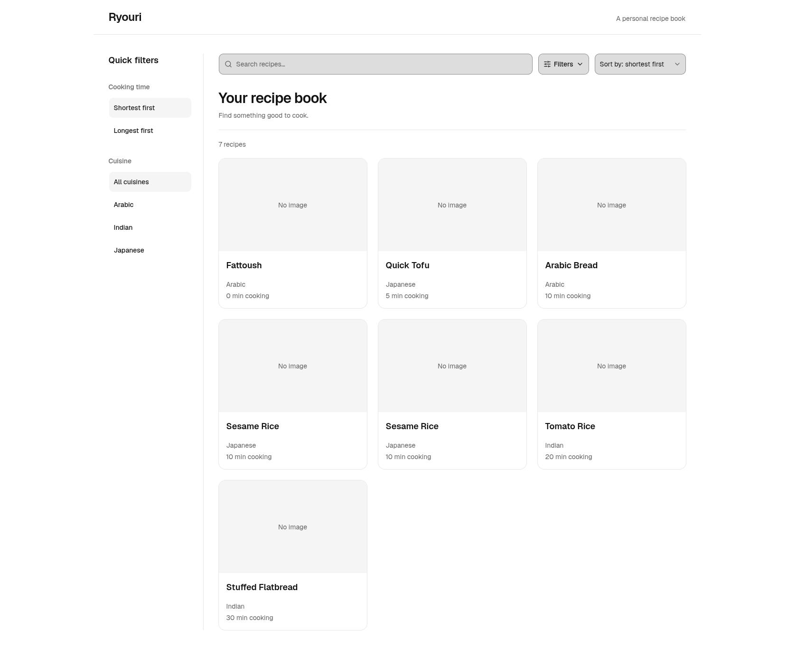
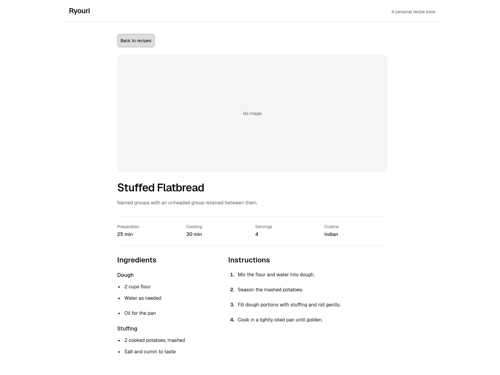
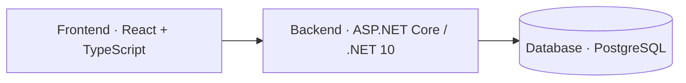

# Ryouri

A self-hosted personal recipe book built with React, ASP.NET Core, and PostgreSQL.
Browse recipes, filter by cuisine, sort by cooking time, and follow ordered
instructions with plain or grouped ingredients.

## Preview

### Recipe collection



### Recipe detail



Screenshots show the current desktop reader using sample recipes. Recipe images
currently use placeholders. YAML import and image uploads are not implemented yet.

## Architecture



## Run locally

Requirements: [Vite+](https://viteplus.dev/guide/), .NET 10 SDK, and rootless
Podman with `podman-compose`. Run commands from the repository root unless a
step changes directories. Keep the backend and frontend running in separate
terminals.

### 1. Database

Create a local environment file and set a strong password in it:

```sh
cd apps/database
cp .env.example .env
# Edit .env: set POSTGRES_PASSWORD and, optionally, POSTGRES_PORT=55432.
mkdir -p "$HOME/.local/state/ryouri/postgres"
podman-compose up -d
podman-compose exec -T postgres pg_isready -U ryouri -d ryouri
```

The host directory `~/.local/state/ryouri/postgres` stores persistent data. It is
mounted at `/var/lib/postgresql/data` **inside the container**; no host system
PostgreSQL directory is used. The database port binds to localhost only and
defaults to `5432`; choose a free port in `.env` if needed.

A fresh database applies migrations automatically. For an existing Ryouri
database, apply only migrations that have not already been applied, in filename
order. Do not reset or delete an existing data directory to apply a migration.

Optionally load sample recipes after PostgreSQL is ready:

```sh
podman-compose exec -T postgres psql -v ON_ERROR_STOP=1 -U ryouri -d ryouri < seed.sql
cd ../..
```

The seed preserves recipes whose IDs already exist. If you skip seeding, return
to the repository root with `cd ../..` before continuing.

### 2. Backend

Set the connection string using the password and host port from your database
`.env`. This example uses port `55432`; use `5432` if you kept the default.
The shell prompts for the password instead of putting it in command history.

```sh
read -r -s -p 'Database password: ' DB_PASSWORD; printf '\n'
export ConnectionStrings__Recipes="Host=127.0.0.1;Port=55432;Database=ryouri;Username=ryouri;Password=\"${DB_PASSWORD//\"/\"\"}\""
unset DB_PASSWORD
dotnet run --project apps/api/Api.csproj --no-launch-profile --urls http://localhost:5101
```

The password prompt/escaping above uses Bash. The API listens at
`http://localhost:5101`; check it at `/api/recipes`.

### 3. Frontend

In another terminal, from the repository root:

```sh
vp install
vp run dev
```

Open the localhost URL printed by Vite, normally `http://localhost:5173`.
The development server forwards `/api` and `/images` requests to the backend on
port `5101`.

Full-stack Docker Compose deployment will be documented separately. This local
setup is intended for localhost or a trusted private network, not public exposure.
