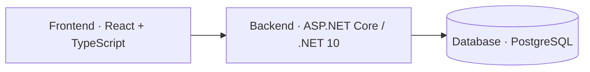

# Ryouri

A self-hosted personal recipe book built with React, ASP.NET Core, and PostgreSQL.
Browse recipes, filter by cuisine, sort by cooking time, and follow ordered
instructions with plain or grouped ingredients.

## Screenshots

### Recipe collection


### Recipe detail


Screenshots show the current desktop reader using sample recipes. Recipe images
currently use placeholders. YAML import and image uploads are not implemented yet.

## Architecture



## Run locally

Requirements: [Vite+](https://viteplus.dev/guide/), .NET 10 SDK, and Docker
with Docker Compose, or Podman with `podman-compose`. The examples below use
Docker; replace `docker compose` with `podman-compose` if you use Podman.
Run commands from the repository root unless a step changes directories. Keep
the backend and frontend running in separate terminals.

### 1. Database

Create a local environment file and set a strong password in it:

```sh
cd apps/database
cp .env.example .env
# Edit .env: set POSTGRES_PASSWORD and, optionally, POSTGRES_PORT=55432.
mkdir -p "$HOME/.local/state/ryouri/postgres"
docker compose up -d
docker compose exec -T postgres pg_isready -U ryouri -d ryouri
```

By default, database files live in `~/.local/state/ryouri/postgres` on your host,
mounted at `/var/lib/postgresql/data` inside the container. To choose another
host directory, change the first volume entry in `compose.yaml`. Alternatively,
use a container-managed named volume:

Replace the first entry under `services.postgres.volumes` with:

```yaml
- postgres_data:/var/lib/postgresql/data
```

Then add this at the top level of `compose.yaml`:

```yaml
volumes:
  postgres_data:
```

Both options keep data across container recreation. Do not remove the volume or
host directory unless you intend to delete the database. Changing storage does
not migrate existing data.

The database port binds to localhost only and defaults to `5432`; choose a free
port in `.env` if needed.

A fresh database applies migrations automatically. For an existing Ryouri
database, apply only migrations that have not already been applied, in filename
order. Do not reset or delete an existing data directory to apply a migration.

Optionally load sample recipes after PostgreSQL is ready:

```sh
docker compose exec -T postgres psql -v ON_ERROR_STOP=1 -U ryouri -d ryouri < seed.sql
cd ../..
```

The seed preserves recipes whose IDs already exist. If you skip seeding, return
to the repository root with `cd ../..` before continuing.

### 2. Backend

Set the connection string using the password and host port from your database
`.env`. This example uses port `55432`; use `5432` if you kept the default.
The shell prompts for the password instead of putting it in command history.

```sh
read -r -s -p 'Database password: ' DB_PASSWORD; printf '\n'
export ConnectionStrings__Recipes="Host=127.0.0.1;Port=55432;Database=ryouri;Username=ryouri;Password=\"${DB_PASSWORD//\"/\"\"}\""
unset DB_PASSWORD
dotnet run --project apps/api/Api.csproj --no-launch-profile --urls http://localhost:5101
```

The password prompt/escaping above uses Bash. The API listens at
`http://localhost:5101`; check it at `/api/recipes`.

### 3. Frontend

In another terminal, from the repository root:

```sh
vp install
vp run dev
```

Open the localhost URL printed by Vite, normally `http://localhost:5173`.
The development server forwards `/api` and `/images` requests to the backend on
port `5101`.

This setup is intended for localhost or a trusted private network, not public
exposure.
