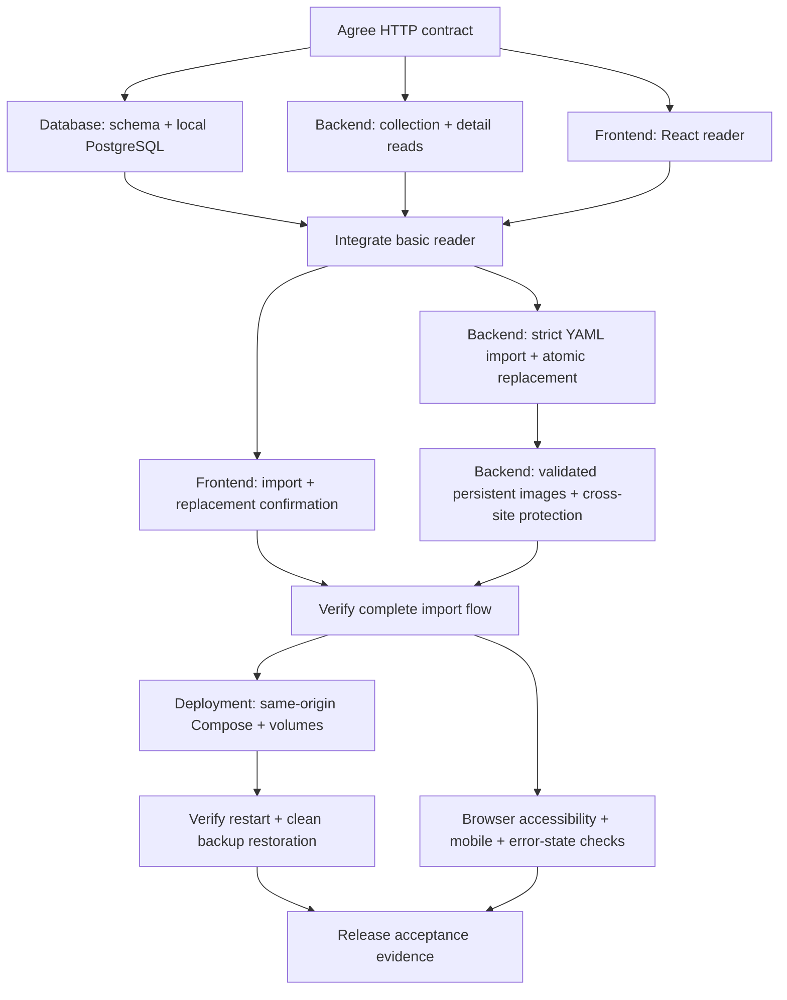

# Ryouri activity network

Baseline: SRS.md v1.1. Build the smallest working reader first, then import,
images, and operational proof. No feature outside the SRS is authorized.

## Shared HTTP contract

- `GET /api/recipes?sort=asc|desc&cuisine=...`: JSON array of summaries:
  `id`, `title`, `cuisine`, `cookMinutes`, `imageUrl` (nullable).
  Default ascending; cook-time direction never reverses title/ID tie-breaks.
- `GET /api/cuisines`: string array, trimmed and case-insensitively unique,
  independent of the current filter.
- `GET /api/recipes/{id}`: recipe fields from SRS section 6, with optional
  `description` and nullable `imageUrl`; 404 for unknown ID.
- `POST /api/recipes/import`: multipart `recipe` YAML file, optional `image`,
  `replace` boolean (default false). Success returns persisted detail (201
  create / 200 replace); 409 requires explicit replacement confirmation.
- Errors: Problem Details; validation includes field-keyed `errors` arrays.
- Browser writes send `X-Ryouri-Request: 1`; API rejects writes without this
  header and unapproved origins. No permissive CORS. Deployment is same-origin.
- Images served under `/images/` with server-generated names.

## Ownership and commit/PR rules

| Lane | Owned paths | First PR | Follow-up PRs |
| --- | --- | --- | --- |
| Database | `apps/database/` | Versioned one-table schema and local database setup | Only schema changes proven necessary |
| Backend | `apps/api/` | Real recipe read endpoints and tests | Strict import/replacement; validated images/security |
| Frontend | `apps/website/` | React collection/detail and read-state checks | Import confirmation and errors |
| Tooling | root manifests/lock/config only | Dependency/workspace integration when needed | Validation tooling only |
| Operations | deployment files and operational docs | Same-origin deployment after integration | Restore evidence |
| Planning | `docs/activity-network.md` | This network | Progress and acceptance evidence |

Each commit stages explicit owned paths, never `git add .`. Separate worktrees
and branches isolate lanes. Root lockfile changes belong to a separate tooling
commit, not a frontend/backend commit. PRs target main for independent first
slices; dependent follow-ups stack on their predecessor until merged. Never
merge or force-push without user authorization. Push feature branches and open
PRs only; local implementation does not imply release acceptance.

## Verification gates

1. Database: apply schema to PostgreSQL and exercise constraints if Docker is
   available; otherwise record blocked runtime proof explicitly.
2. Backend: .NET build/tests; prove ordering/filter composition, missing IDs,
   invalid imports, create collision and full replacement preservation.
3. Frontend: Vite+ checks/build/tests, then browser navigation/refresh, distinct
   states, keyboard and mobile checks. No mock-only claim of integration.
4. Security/images: adversarial YAML and image checks; cross-site write denial.
5. Deployment: real retained-volume recreation and clean restore of both recipe
   data and referenced images. Record evidence, not assumptions.

## Status

- [x] Read SRS and inspect existing starter/workspace.
- [x] Establish network, ownership, and shared HTTP contract.
- [ ] Database basic slice.
- [ ] Backend reader slice.
- [ ] Frontend reader slice.
- [ ] Integrate reader, then launch dependent follow-up slices.
- [ ] Complete acceptance evidence AC-01 through AC-20.
